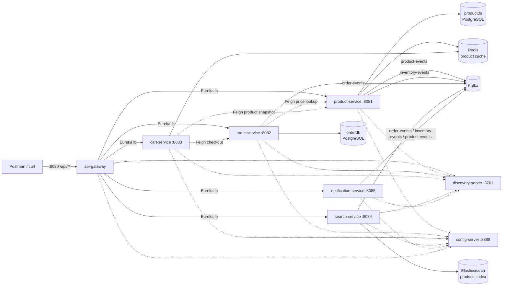

# ShopStream

A distributed e-commerce backend built with Spring Boot, Spring Cloud, Kafka,
PostgreSQL, Redis and Elasticsearch. All client traffic enters through one API
gateway; every business service owns its own data store.

This repository is the submission-ready version of the course project. The
frontend was intentionally removed: the assignment only requires the gateway
API to be demonstrated with Postman or curl.

## Architecture



Only `api-gateway:8080` is published to the host. PostgreSQL, Redis, Kafka,
Elasticsearch, Eureka, Config Server and all business services stay on the
internal Compose network.

## Services

| Service | Port | Responsibility | Storage |
| --- | --- | --- | --- |
| `api-gateway` | 8080 | Java DSL routes, `StripPrefix=1`, request-id filter | — |
| `discovery-server` | 8761 | Eureka registry | — |
| `config-server` | 8888 | Native Spring Cloud Config, serves `config-repo/` | `config-repo/` |
| `product-service` | 8081 | Product CRUD, Redis cache-aside, stock reservation Saga participant, publishes `product-events` / `inventory-events` | PostgreSQL `productdb` + Redis |
| `order-service` | 8082 | Order creation, Feign price lookup, Saga orchestration, publishes `order-events`, consumes `inventory-events` | PostgreSQL `orderdb` |
| `cart-service` | 8083 | Redis cart API, checkout through Feign | Redis |
| `search-service` | 8084 | Consumes `product-events`, maintains the Elasticsearch index, search API | Elasticsearch |
| `notification-service` | 8085 | Consumes all three topics, keeps an observable notification log | In-memory (no database by design) |

## What is different in this implementation

The external behaviour matches the assignment, but the internals deliberately
use a different approach from the classic tutorial solution:

- **PostgreSQL instead of MySQL**, one database container per stateful service.
- **Spring Cloud Stream (Kafka binder)** instead of `KafkaTemplate` /
  `@KafkaListener`; a common JSON envelope is shared by all events.
- **Explicit cache-aside in `ProductService`** instead of `@Cacheable`, so 404
  responses are never cached and Redis failures fall back to the database.
- **Java DSL gateway routes** instead of YAML route definitions.
- **Elasticsearch Java client** for queries instead of the repository query
  derivation API.
- **Cart as one JSON document in Redis** with a sliding TTL instead of a Hash.
- **Idempotent inventory Saga** with a `stock_reservations` table and
  PostgreSQL row locks (`SELECT ... FOR UPDATE`).
- **Docker Compose publishes only the gateway**, with a separate
  `docker-compose.dev.yml` overlay for debugging.
- **No frontend**; the demo is gateway-only, as allowed by the assignment.

## Quick start

```bash
docker compose up -d --build
docker compose ps
```

The first start builds eight images and may take several minutes. Wait until
`api-gateway` is healthy, then open:

```bash
curl http://localhost:8080/api/products
```

### 1. Create products

```bash
curl -X POST http://localhost:8080/api/products \
  -H "Content-Type: application/json" \
  -d '{"name":"Laptop","description":"14 inch developer laptop","category":"electronics","price":1299.00,"stock":5}'

curl -X POST http://localhost:8080/api/products \
  -H "Content-Type: application/json" \
  -d '{"name":"Mechanical Keyboard","description":"Hot-swappable keyboard","category":"accessories","price":89.00,"stock":10}'
```

The response contains the generated `id`. Product reads expose an `X-Cache`
header (`HIT` or `MISS`), which is useful for the Redis demo.

### 2. Search

The search index is updated asynchronously through Kafka:

```bash
curl "http://localhost:8080/api/search?text=laptop"
curl "http://localhost:8080/api/search?category=electronics&minPrice=100&sort=priceAsc"
```

If the request arrives before the consumer caught up, retry after a second.

### 3. Cart and checkout

```bash
curl -X POST http://localhost:8080/api/carts/alice/items \
  -H "Content-Type: application/json" \
  -d '{"productId":1,"quantity":2}'

curl http://localhost:8080/api/carts/alice

curl -X POST http://localhost:8080/api/carts/alice/checkout
```

The checkout call creates an order through `order-service` and clears the cart
only after the order was accepted.

### 4. Order and inventory Saga

```bash
curl -X POST http://localhost:8080/api/orders \
  -H "Content-Type: application/json" \
  -d '{"items":[{"productId":1,"quantity":2}]}'

curl http://localhost:8080/api/orders/1
```

An order is created as `PENDING`. `product-service` consumes `OrderCreated`,
locks the product rows, reserves stock and publishes `StockReserved` or
`StockRejected`. `order-service` consumes the result and moves the order to
`CONFIRMED` or `REJECTED`.

### 5. Notifications

```bash
curl http://localhost:8080/api/notifications
curl http://localhost:8080/api/notifications/1
```

## API

All paths go through the gateway.

| Method | Path | Purpose |
| --- | --- | --- |
| GET | `/api/products` | List products |
| GET | `/api/products/{id}` | Product detail (`X-Cache: HIT/MISS`) |
| POST | `/api/products` | Create product |
| PUT | `/api/products/{id}` | Update product |
| DELETE | `/api/products/{id}` | Delete product |
| GET | `/api/search` | Search: `text`, `category`, `minPrice`, `maxPrice`, `page`, `size`, `sort` |
| GET | `/api/carts/{userId}` | Read cart |
| POST | `/api/carts/{userId}/items` | Add item `{productId, quantity}` |
| PUT | `/api/carts/{userId}/items/{productId}` | Set quantity |
| DELETE | `/api/carts/{userId}/items/{productId}` | Remove item |
| DELETE | `/api/carts/{userId}` | Clear cart |
| POST | `/api/carts/{userId}/checkout` | Create an order from the cart |
| POST | `/api/orders` | Create order |
| GET | `/api/orders/{id}` | Order status and items |
| GET | `/api/orders?status=PENDING` | List orders, optional status filter |
| GET | `/api/notifications` | Latest notifications |
| GET | `/api/notifications/{orderId}` | Notifications for one order |

## Event flow

```
product-service ──ProductCreated/Updated/Deleted──▶ product-events
                                                   ├──▶ search-service (index)
                                                   └──▶ notification-service

order-service ──OrderCreated──▶ order-events ─────────▶ product-service
                                                 └────▶ notification-service

product-service ──StockReserved/StockRejected──▶ inventory-events
                                                 ├────▶ order-service (status)
                                                 └────▶ notification-service

order-service ──OrderConfirmed/OrderRejected──▶ order-events
```

Every message uses the same envelope:

```json
{
  "eventId": "uuid",
  "eventType": "OrderCreated",
  "occurredAt": "2026-11-11T12:00:00Z",
  "payload": { }
}
```

See [docs/EVENTS.md](docs/EVENTS.md) for the payload of each event.

## Data model

**productdb**

```
products(id PK, name, description, category, price DECIMAL, stock INT)
stock_reservations(order_id PK, status, reason, created_at)
```

**orderdb**

```
orders(id PK, status, total_price, created_at, updated_at, failure_reason, version)
order_items(id PK, order_id FK, product_id, quantity, unit_price)
```

**Redis**

- `product:{id}` — cached product JSON, TTL 2 minutes.
- `cart:{userId}` — cart JSON, sliding TTL 30 minutes.

**Elasticsearch**

- index `products`, explicit mapping from `ProductDocument`, one shard, zero
  replicas, `name` as `text` plus `name.keyword`, `description` as `text`,
  `category` as `keyword`, `price` as `double`, `stock` as `integer`.

## Configuration and discovery

- Every service imports `configserver:http://config-server:8888` and fails fast
  if the Config Server is not available.
- `config-repo/application.yml` holds shared Eureka and Kafka settings;
  `config-repo/<service>.yml` holds service-specific datasource, Redis,
  Elasticsearch, Feign and Stream bindings.
- Eureka service names are used by the gateway (`lb://...`) and by Feign
  (`@FeignClient(name = "product-service")`), so no host names or fixed
  container addresses appear in business code.

## Development

The default Compose file is the submission/demo file: only 8080 is exposed.
For debugging, use the overlay that also publishes infrastructure ports:

```bash
docker compose -f docker-compose.yml -f docker-compose.dev.yml up -d --build
```

| Endpoint | URL |
| --- | --- |
| Gateway | http://localhost:8080 |
| Eureka | http://localhost:8761 |
| Config Server | http://localhost:8888 |
| Elasticsearch | http://localhost:9200 |
| Product PostgreSQL | localhost:5432 (`product` / `product-pw`) |
| Order PostgreSQL | localhost:5433 (`order` / `order-pw`) |
| Redis | localhost:6379 (password `mypass`) |
| Kafka (host listener) | localhost:29092 |

When running a service from an IDE, start `discovery-server` and
`config-server` first, then run the service with:

```
CONFIG_SERVER_URL=http://localhost:8888
EUREKA_URL=http://localhost:8761/eureka/
```

## Tests

Each service has JUnit 5 + Mockito unit tests for its core logic:

```bash
cd product-service && ./mvnw test
cd order-service   && ./mvnw test
cd cart-service    && ./mvnw test
cd search-service  && ./mvnw test
cd notification-service && ./mvnw test
```

The tests cover cache hit/miss, stock reservation and rejection, order totals,
inventory-result idempotency, cart persistence/checkout, ES event handling and
notification de-duplication.

## Documentation

- [Design report (Chinese)](docs/DESIGN-REPORT.md)
- [15-minute demo script (Chinese)](docs/DEMO.md)
- [Event contracts](docs/EVENTS.md)
- [Postman collection](postman/ShopStream.postman_collection.json)

## Known limitations

- The project is a teaching/demo system: there is no authentication or user
  account service. Cart user IDs are demo identifiers.
- Kafka consumers use at-least-once delivery. The inventory Saga is idempotent
  through `stock_reservations`, but there is no transactional outbox yet; a
  crash between database commit and event publication can leave an order
  `PENDING`.
- Search is eventually consistent because it is fed by Kafka.
- `docker compose up` exposes only the gateway by design; use the dev overlay
  when you need direct access to infrastructure.
