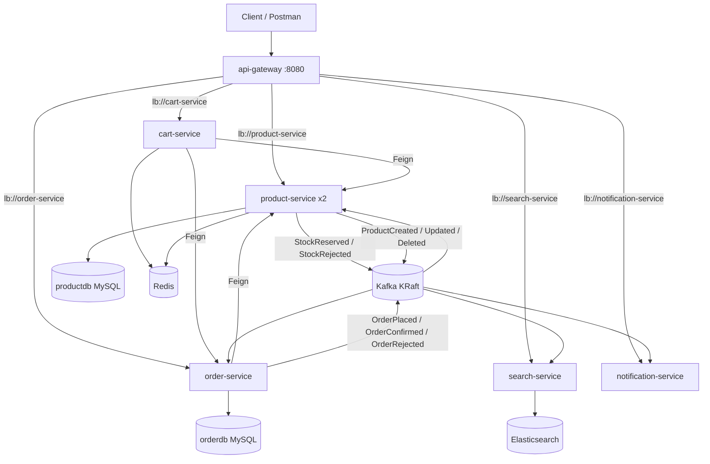

# ShopStream

ShopStream is the semester project of the Distributed Systems course: a small
e-commerce backend made of five business services and three infrastructure
services. All client traffic enters through one API gateway, every service owns
its own data store, and services talk to each other through REST (Feign) or
Kafka events.

## Architecture



## Services

| Service | Port | Data store | Responsibility |
| --- | --- | --- | --- |
| `api-gateway` | 8080 (only published port) | none | Spring Cloud Gateway routes, `X-Request-Id` filter |
| `discovery-server` | 8761 | none | Eureka registry (`@EnableEurekaServer`) |
| `config-server` | 8888 | `config-repo/` folder | Central configuration (`@EnableConfigServer`) |
| `product-service` | 8081 | MySQL `productdb`, Redis cache | Product CRUD, stock reservation, product cache |
| `order-service` | 8082 | MySQL `orderdb` | Orders, PENDING → CONFIRMED/REJECTED |
| `cart-service` | 8083 | Redis | Cart hash per user, checkout |
| `search-service` | 8084 | Elasticsearch | Product search index |
| `notification-service` | 8085 | none (log only) | One "email" log line per event |

## How the project description is implemented

| Step | Task | Implementation |
| --- | --- | --- |
| 1 | One MySQL database per service | `product-mysql` (`productdb`) and `order-mysql` (`orderdb`), MySQL 8.4, named volumes, `depends_on` with health checks; the JDBC URLs point to the container names |
| 1 | Product CRUD, order create/read | `ProductController` (`/products`), `OrderController` (`/orders`), JPA repositories |
| 2 | Kafka in KRaft mode | single `apache/kafka:3.9.1` container, `KAFKA_PROCESS_ROLES=broker,controller`, no ZooKeeper |
| 2 | Topics from Java, 3 partitions | `KafkaTopicConfig` with `NewTopic` / `TopicBuilder` in product- and order-service |
| 2 | JSON events, `orderId` / `productId` as key | `KafkaTemplate<String, Object>` + `JsonSerializer`, `@KafkaListener` + `JsonDeserializer`; key = aggregate id |
| 2 | Order lifecycle | `OrderService` saves `PENDING`, `OrderEventPublisher` publishes `OrderPlaced` after commit, `InventoryEventsListener` applies the inventory result |
| 2 | Stock reservation idempotent | `stock_reservations.order_id` is the primary key; the order state machine only accepts one transition from `PENDING` |
| 3 | Index mapping | `ProductDocument` with `@Document(indexName = "products")`, `@Field` (`name` text + `name.keyword`, `category` keyword, `price` double, `stock` integer) |
| 3 | Index maintenance | `ProductEventsListener` saves/deletes through `ProductSearchRepository` |
| 3 | Search API | `SearchService`: derived `findByCategory` for the simple case, `ElasticsearchOperations` with a native bool query for text + category + price + paging + sort |
| 4 | Cart as Redis hash | `Cart` annotated `@RedisHash("carts")`, `@Id userId`, `CartRepository extends CrudRepository<Cart, String>` |
| 4 | Cart expiry | `@TimeToLive` field, refreshed on every save; **TTL = 30 minutes (1800 s)** |
| 4 | Product cache | `@Cacheable("products")` on `GET /products/{id}`, `@CacheEvict` on update/delete and on stock reservation |
| 5 | Two product instances | `product-service-1` and `product-service-2` in `docker-compose.yml`, both registered in Eureka, one Kafka consumer group |
| 5 | Config server | `config-server` with the `config-repo/` folder: shared `application.yml` plus one file per service, including database URLs, Kafka settings and `app.topics.*` |
| 5 | Feign with service names | `ProductClient`, `OrderClient` (`@FeignClient(name = "product-service")`, etc.) |
| 5 | Gateway + `X-Request-Id` | routes `/api/products/**`, `/api/orders/**`, `/api/carts/**`, `/api/search/**` to `lb://`, `StripPrefix`, `XRequestIdFilter` |

## Run it

```powershell
docker compose up -d --build
docker compose ps
```

The first build takes several minutes (five Maven builds plus Kafka and
Elasticsearch images). When every container is `healthy`:

```powershell
curl.exe http://localhost:8080/api/products
```

Only `api-gateway` publishes a host port. To inspect MySQL, Redis, Kafka,
Elasticsearch, Eureka or the Config Server from the host, add the development
overlay:

```powershell
docker compose -f docker-compose.yml -f docker-compose.dev.yml up -d
```

Dev ports: Eureka 8761, Config Server 8888, Elasticsearch 9200, Redis 6379,
Kafka 29092, product MySQL 3306 (`product` / `product-pw`), order MySQL 3307
(`order` / `order-pw`).

## Demo walkthrough (15 minutes)

1. `docker compose ps` — only the gateway has a published port.
2. `http://localhost:8761` — seven applications registered (gateway, order,
   cart, search, notification, config server and product), `PRODUCT-SERVICE`
   with two instances.
3. Create two products, `GET /api/products/{id}` twice: the first request logs
   `Cache miss for product ... reading from MySQL`, the second does not. Check
   `docker compose exec redis redis-cli -a mypass KEYS 'products::*'`.
4. Update the product: `@CacheEvict` removes the key; the next read is a miss.
5. `GET /api/search?text=laptop` and
   `GET /api/search?category=electronics&minPrice=500&sort=priceAsc`.
6. `POST /api/carts/demo-user/items`, `GET /api/carts/demo-user`,
   `docker compose exec redis redis-cli -a mypass HGETALL carts:demo-user`,
   `TTL carts:demo-user` (≈1800 s).
7. `POST /api/carts/demo-user/checkout`, then poll
   `GET /api/orders/{id}` until `CONFIRMED`; a second order with quantity 999
   becomes `REJECTED`.
8. Show the logs of `product-service-1`, `product-service-2`, `order-service`,
   `notification-service` — key = orderId, partition and offset, and the
   `X-Request-Id` propagated by the gateway.

## Tests

```powershell
.\scripts\run-tests.ps1          # all five services
.\scripts\run-tests.ps1 -Modules cart-service   # one service
```

The script finds a JDK and a Maven installation, runs `mvn test` module by
module and prints one line per service. The unit tests do not need Docker: JUnit
5 + Mockito cover product CRUD and cache annotations, stock reservation
(including the cache eviction), order state transitions, cart TTL and checkout,
the search listener and notification de-duplication.

39 tests in ten classes; `BUILD SUCCESS` in every module. On a JDK newer than
23 the tests need `-DargLine=-Dnet.bytebuddy.experimental=true`, because the
Byte Buddy version bundled with Mockito refuses to instrument newer class files;
that is a tooling limit, not a failure of the project.

## Design notes

- **Database**: MySQL 8.4, one container and one database per service. No
  service reads another service's schema.
- **Kafka**: single broker in KRaft mode; three topics (`order-events`,
  `inventory-events`, `product-events`) with three partitions each, declared by
  `NewTopic` / `TopicBuilder`. The topic names are kept in `config-repo`.
- **Events**: JSON envelope `{eventId, eventType, occurredAt, payload}`. The
  message key is `orderId` or `productId`, so all events of one aggregate stay
  in one partition and keep their order.
- **Cart TTL**: 30 minutes, refreshed on every write; the period is
  `cart.time-to-live-seconds: 1800` in `config-repo/cart-service.yml`.
- **Product cache TTL**: 2 minutes (`spring.cache.redis.time-to-live: 2m`), and
  the entry is evicted on every product change or stock reservation.
- **Screenshots**: `docs/screenshots/` holds the fourteen images used in the
  report. Every terminal image is produced by `scripts/evidence.ps1 <section>`,
  the test summary by `scripts/run-tests.ps1`, and Appendix A of the report maps
  each figure to the command behind it.
- **Documents**: `ShopStream-Design-Report.pdf` in the repository root (exported
  from `docs/DESIGN-REPORT.md`), `docs/DESIGN-REPORT.md` (report source,
  including the per-task coverage table), `docs/REVISION-SUMMARY.md`
  (point-by-point response to the review), `docs/EVENTS.md` (topics and event
  contract), `docs/DEMO.md` (demo script), `docs/shopstream-architecture.png`
  (the topology figure, regenerated by `scripts/render_architecture.py`).

