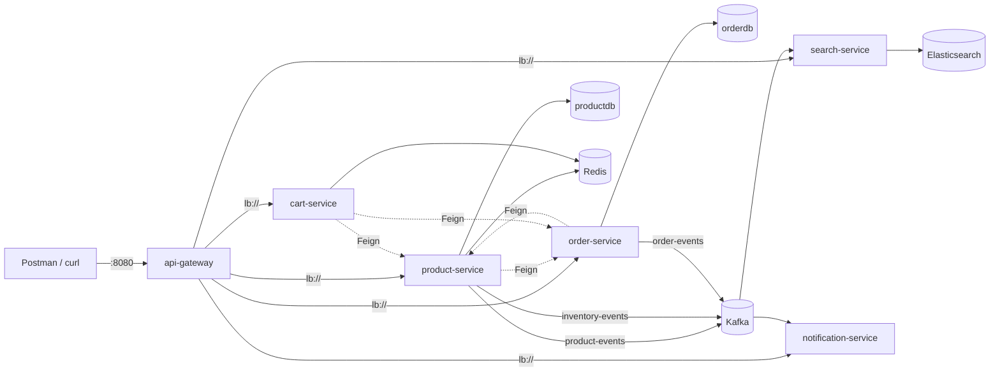

# ShopStream 分布式电商平台 — 设计报告

## 1. 项目概述

ShopStream 是一个按微服务边界拆分的分布式电商后端。系统包含 5 个业务服务
（商品、订单、购物车、搜索、通知）和 3 个基础设施服务（Eureka 注册中心、
Spring Cloud Config 配置中心、API 网关），并使用 PostgreSQL、Redis、Kafka、
Elasticsearch 与 Docker Compose 组成完整运行环境。

项目的验收方式不是网页商城，而是通过 Postman/curl 访问唯一入口
`http://localhost:8080/api/**`，演示服务发现、网关路由、Feign 调用、Redis
缓存与购物车、Kafka 异步事件、Elasticsearch 搜索，以及库存确认/拒绝的
Saga 流程。

## 2. 总体架构



设计原则：

1. **每个服务独立数据存储**。商品和订单各自使用独立的 PostgreSQL 容器与
   数据库，购物车使用 Redis，搜索使用 Elasticsearch，通知服务不落库。
2. **唯一外部入口**。`docker-compose.yml` 只发布 `api-gateway:8080`，其余
   服务、数据库、消息中间件都只在 Compose 内部网络中可见。
3. **同步调用只用于读取**。订单创建时通过 Feign 读取商品当前价格；库存扣减
   通过 Kafka 异步完成，避免长事务和跨服务数据库锁。
4. **事件驱动最终一致**。商品变更、订单创建、库存结果都通过事件传播；搜索
   索引和通知因此可以独立扩展。

## 3. 技术选型与“不同做法”

课程项目常见的教程实现是 MySQL + 原生 `KafkaTemplate`/`@KafkaListener` +
`@Cacheable` + YAML 网关路由。本项目在保持外部行为和验收要求不变的前提下，
内部采用了另一套实现：

| 领域 | 本项目做法 | 带来的好处 |
| --- | --- | --- |
| 关系数据库 | PostgreSQL 16，每服务独立容器和账号 | 与 MySQL 方案区分；行锁语义清晰，便于演示 `SELECT ... FOR UPDATE` |
| 消息 | Spring Cloud Stream + Kafka binder | 绑定、消费组、重试和内容类型由框架统一管理；业务代码不直接依赖 Kafka API |
| 事件格式 | 统一 JSON envelope + 各服务独立 DTO | 服务之间不共享 Java 类，避免类名进入 Kafka header 造成耦合 |
| 缓存 | `ProductService` 中显式 cache-aside + 2 分钟 TTL | 不会缓存 404；Redis 故障时自动回退数据库 |
| 网关 | Java DSL `RouteLocator` | 路由类型安全、可单元测试、与代码放在一起 |
| 搜索 | Elasticsearch Java client 直接构造 bool query | 查询结构显式，便于演示 multi-match/term/range/sort |
| 购物车 | Redis 单 Key JSON 文档 + 30 分钟滑动 TTL | 购物车整体原子读写，演示简单 |
| 库存 | `stock_reservations` 表 + 悲观行锁 + 幂等消费 | 重复消息不会重复扣库存；并发订单不会超卖 |
| 通知 | 内存环形存储 + REST 查询接口 | 课程不要求通知落库，同时让异步链路可观察 |
| 部署 | 主 Compose 只暴露网关，另有 dev overlay | 同时满足“只暴露网关”和本地调试需求 |

## 4. 服务设计

### 4.1 api-gateway（8080）

- 使用 `RouteLocatorBuilder` 声明 5 条路由，统一前缀 `/api/**`，
  `StripPrefix=1` 后转发到 Eureka 中的服务名。
- `XRequestIdFilter` 为每个请求生成/透传 `X-Request-Id`，写回响应头并记录
  方法、路径、状态码和耗时。
- 不开启自动发现路由，避免把 Eureka 中的所有服务无意暴露出去。

### 4.2 discovery-server（8761）

- `@EnableEurekaServer`，关闭自注册和注册表拉取。
- 关闭自我保护并缩短剔除间隔，便于演示服务上下线。
- 所有业务服务通过 `spring.application.name` 注册，网关和 Feign 只使用
  服务名，不写死容器地址。

### 4.3 config-server（8888）

- `native` profile，从挂载的 `config-repo/` 读取配置。
- `config-repo/application.yml` 保存公共 Eureka/Kafka/重试配置；
  `config-repo/<service>.yml` 保存各服务的 datasource、Redis、Elasticsearch、
  Feign、Stream binding。
- 业务服务使用 `spring.config.import=configserver:...` 且 `fail-fast=true`，
  启动时配置中心不可用则快速失败，避免带着错误配置运行。

### 4.4 product-service（8081）

- 商品 CRUD，JPA + PostgreSQL。
- 读接口使用 Redis cache-aside：先读 `product:{id}`，未命中查库并写回，
  响应头返回 `X-Cache: HIT/MISS`；更新/删除时主动失效。
- 商品写操作通过 `@TransactionalEventListener(AFTER_COMMIT)` 在事务提交后
  发布 `ProductCreated/Updated/Deleted`，避免“数据库回滚但消息已发出”。
- 消费 `order-events` 中的 `OrderCreated`，在事务中按商品 id 排序后逐个
  `SELECT ... FOR UPDATE`，检查并扣减库存；成功发 `StockReserved`，失败回滚
  并记录 `StockRejected`。

### 4.5 order-service（8082）

- 订单与订单项两张表，保存下单时的单价快照，后续商品改价不影响历史订单。
- 创建订单时通过 Feign 调用 `product-service` 获取当前价格，计算总价。
- 订单初始状态 `PENDING`；事务提交后发 `OrderCreated`。
- 消费 `inventory-events`，只允许 `PENDING -> CONFIRMED/REJECTED` 的状态
  迁移；重复结果直接忽略，保证幂等。
- 状态变化后发 `OrderConfirmed/OrderRejected`，供通知服务消费。

### 4.6 cart-service（8083）

- 购物车以 JSON 文档保存在 `cart:{userId}`，每次修改刷新 30 分钟 TTL。
- 添加商品时通过 Feign 读取商品名称、价格和库存，并检查数量上限（99）和
  当前库存。
- 结算时调用 `order-service` 创建订单；只有下单成功后才删除购物车，失败可
  直接重试。
- 用户 id 只允许字母、数字、下划线和短横线，避免把任意字符串拼进 Redis Key。

### 4.7 search-service（8084）

- 消费 `product-events`，删除事件调用 `deleteById`，创建/更新事件写入 ES。
- 启动时用 `IndexOperations.createWithMapping()` 显式创建索引，字段类型不依赖
  ES 的动态映射。
- 查询使用 Elasticsearch Java client 构造 bool query：
  `multi_match(name^2, description)`、`term(category)`、
  `range(price)`、分页与排序；返回带 `totalElements/totalPages` 的分页对象。

### 4.8 notification-service（8085）

- 三个 consumer 分别订阅 `order-events`、`inventory-events`、
  `product-events`，使用独立消费组，不影响业务消费者。
- 课程要求通知服务只记日志、不需要数据库，因此使用有界内存列表保存最近
  200 条通知，并额外提供 `GET /notifications` 让演示可以直接看到异步结果。
- 使用 `eventId` 去重，Kafka 重投不会产生重复通知。

## 5. 数据模型

### productdb

```sql
products(
  id BIGINT PRIMARY KEY,
  name VARCHAR(120) NOT NULL,
  description VARCHAR(2000),
  category VARCHAR(80),
  price NUMERIC(12,2) NOT NULL,
  stock INTEGER NOT NULL
)

stock_reservations(
  order_id BIGINT PRIMARY KEY,
  status VARCHAR(16) NOT NULL,   -- RESERVED / REJECTED
  reason VARCHAR(500),
  created_at TIMESTAMPTZ NOT NULL
)
```

### orderdb

```sql
orders(
  id BIGINT PRIMARY KEY,
  status VARCHAR(16) NOT NULL,   -- PENDING / CONFIRMED / REJECTED
  total_price NUMERIC(14,2) NOT NULL,
  created_at TIMESTAMP NOT NULL,
  updated_at TIMESTAMP NOT NULL,
  failure_reason VARCHAR(500),
  version BIGINT
)

order_items(
  id BIGINT PRIMARY KEY,
  order_id BIGINT NOT NULL REFERENCES orders(id),
  product_id BIGINT NOT NULL,
  quantity INTEGER NOT NULL,
  unit_price NUMERIC(12,2) NOT NULL
)
```

`version` 是 JPA 乐观锁字段，防止并发状态更新互相覆盖；`unit_price` 是价格
快照。

### Redis

| Key | Value | TTL |
| --- | --- | --- |
| `product:{id}` | 商品 JSON | 2 分钟 |
| `cart:{userId}` | 购物车 JSON | 30 分钟，每次写操作刷新 |

### Elasticsearch

索引 `products`：1 个分片、0 个副本；`name` 为 `text` + `name.keyword`，
`description` 为 `text`，`category` 为 `keyword`，`price` 为 `double`，
`stock` 为 `integer`。

## 6. 关键流程

### 6.1 商品写入到搜索索引

```
POST /api/products
  → api-gateway
  → product-service：写 PostgreSQL，提交事务
  → AFTER_COMMIT 发布 ProductCreated 到 product-events
  → search-service 消费并 upsert Elasticsearch
  → GET /api/search 可查到
```

这是最终一致：Kafka 是异步的，刚创建的商品可能晚几百毫秒才出现在搜索中。

### 6.2 下单 + 库存 Saga

```
POST /api/orders
  → order-service：Feign 调 product-service 取价
  → 保存 PENDING 订单 + 价格快照
  → 提交后发 OrderCreated
  → product-service 消费：
       按 productId 排序加行锁
       全部库存足够 → 扣减 + 写 stock_reservations(RESERVED)
                      → 发 StockReserved
       任一不足     → 事务回滚 + 写 stock_reservations(REJECTED)
                      → 发 StockRejected
  → order-service 消费结果：
       PENDING + StockReserved → CONFIRMED
       PENDING + StockRejected → REJECTED + failure_reason
  → notification-service 记录全过程
```

**回滚补偿**：库存扣减在同一个数据库事务中完成，任一商品不足会整体回滚，
不会出现“前两个商品扣了、第三个失败”的半成品状态。

**幂等**：`stock_reservations.order_id` 是主键；重复的 `OrderCreated` 直接
返回已有结果并重发事件。订单状态只允许从 `PENDING` 迁移一次，重复的
`StockReserved/StockRejected` 不会改变已完成的订单。

**并发安全**：按商品 id 排序后再加锁，避免两个订单以不同顺序锁定同一批商品
造成死锁；PostgreSQL 行锁保证不会超卖。

### 6.3 购物车结算

```
POST /api/carts/{userId}/items
  → Feign 读取商品快照 → 更新 Redis JSON（TTL 30 分钟）

POST /api/carts/{userId}/checkout
  → 读取购物车
  → Feign POST order-service /orders
  → 下单成功 → 删除购物车 Key
  → 下单失败 → 保留购物车，客户端可重试
```

## 7. 配置、发现与部署

### 配置

配置中心按 `application.yml` + `<service>.yml` 合并下发。数据库地址、Redis
地址、Kafka broker、ES 地址、Feign 超时、Stream binding 都在配置仓库中，
Docker Compose 只通过环境变量覆盖连接地址。

### 服务发现

- 服务启动后向 Eureka 注册，网关通过 `lb://service-name` 负载均衡。
- Feign 客户端使用 `@FeignClient(name = "product-service")`，由 Eureka +
  Spring Cloud LoadBalancer 解析实例。
- Docker 内部通信全部使用 Compose 服务名（`product-postgres`、`kafka`、
  `redis`、`elasticsearch`），不使用 `localhost`。

### 端口暴露

主 `docker-compose.yml` 只有：

```yaml
api-gateway:
  ports:
    - "8080:8080"
```

其他服务没有 `ports`。开发时使用：

```bash
docker compose -f docker-compose.yml -f docker-compose.dev.yml up -d --build
```

`docker-compose.dev.yml` 才把 Eureka、Config、PostgreSQL、Redis、Kafka、
Elasticsearch 映射到宿主机，便于用 IDE 和数据库工具调试。

## 8. 可靠性设计

| 问题 | 处理 |
| --- | --- |
| Redis 不可用 | 商品读取捕获异常并回退数据库；缓存写入失败只记日志，不影响主流程 |
| 重复 Kafka 消息 | 库存预约表主键 + 订单状态机 + 通知 eventId 去重 |
| 消费失败 | Spring Cloud Stream `max-attempts=3` + 指数退避；超过后记录错误日志 |
| 事件早于事务提交 | 使用 `@TransactionalEventListener(AFTER_COMMIT)` |
| 超卖 | PostgreSQL 悲观行锁 + 单事务扣减 |
| 并发状态覆盖 | orders 表 `@Version` 乐观锁 |
| 服务启动顺序 | Compose healthcheck + `depends_on: condition: service_healthy` |
| 配置中心未就绪 | Config Client `fail-fast` + retry，且 Compose 等待 Config Server 健康 |

## 9. 难点与解决

1. **Kafka 事件类型耦合**
   教程方案直接在 header 里传 Java 类名，消费者一改包名就反序列化失败。
   本项目改为统一 JSON envelope，每个服务用自己的 DTO/JsonNode 解析，服务
   之间只依赖事件契约，不依赖共享类。

2. **库存 Saga 的幂等与回滚**
   只靠“消费一次”不可靠。通过 `stock_reservations` 主键记录每个订单的处理
   结果，重复消息直接重发已有结果；扣库存放在一个事务里，失败整体回滚，再由
   另一个事务记录拒绝原因。

3. **“只暴露网关”与调试需求的矛盾**
   主 Compose 只发布 8080，满足验收要求；另提供 `docker-compose.dev.yml`
   覆盖文件，开发时再映射基础设施端口，不污染提交文件。

4. **搜索的最终一致**
   商品写入后立即查搜索可能查不到。报告和演示中明确说明 Kafka 异步链路，
   演示时等待约 1 秒再查；这本身就是分布式系统的正常现象。

5. **配置中心启动顺序**
   Config Client 在容器启动时就要拉配置。通过 Config Server healthcheck +
   `depends_on` 健康条件，加上客户端 fail-fast/retry，避免服务带着空配置
   启动。

## 10. 测试

每个服务都有不依赖外部中间件的 JUnit 5 + Mockito 单元测试：

- product-service：缓存命中/未命中/失效、404、创建事件、库存预约成功/失败/
  重复/空订单、加锁顺序。
- order-service：价格汇总、空订单、库存结果状态迁移、重复结果幂等、未知订单。
- cart-service：空购物车、添加商品与 TTL、库存上限、数量置零删除、结算清空、
  空车结算、损坏 JSON 清理。
- search-service：商品创建索引、删除索引、未知事件、损坏 JSON、索引初始化。
- notification-service：订单/库存/商品通知、eventId 去重、按订单过滤、容量上限。

运行方式：

```bash
cd <service> && ./mvnw test
```

## 11. 局限与可扩展方向

- 无认证/用户体系，购物车 userId 为演示标识；生产环境应增加 OAuth2/JWT 和
  用户服务。
- Kafka 发布与数据库提交之间没有 transactional outbox；极端崩溃窗口可能让
  订单停留在 `PENDING`。可增加 outbox 表 + 定时补偿。
- 搜索索引没有全量重建接口；可在 search-service 增加管理端点，从商品服务
  分页回灌。
- 通知只保存在内存，重启丢失；生产环境可落 PostgreSQL 或接邮件/短信网关。
- 未接入分布式追踪（Micrometer Tracing + Zipkin），目前用 `X-Request-Id`
  串联网关日志。
