# ShopStream — Design Report

**Student:** Pei Shenghui · **Course:** Distributed Systems, University of Miskolc · **Project:** ShopStream, a distributed e-commerce platform · **Submission:** 4 December 2026

## 1. Overview

ShopStream is a Spring Boot application split into five business services
(product, order, cart, search, notification) and three infrastructure services
(Eureka, Config Server, API gateway). Each business service owns its own data
store: two separate MySQL databases, one Redis instance and one Elasticsearch
index. Client traffic enters only through the gateway; the services talk to each
other synchronously through Feign for reads and asynchronously through Kafka for
the order and catalogue workflows.

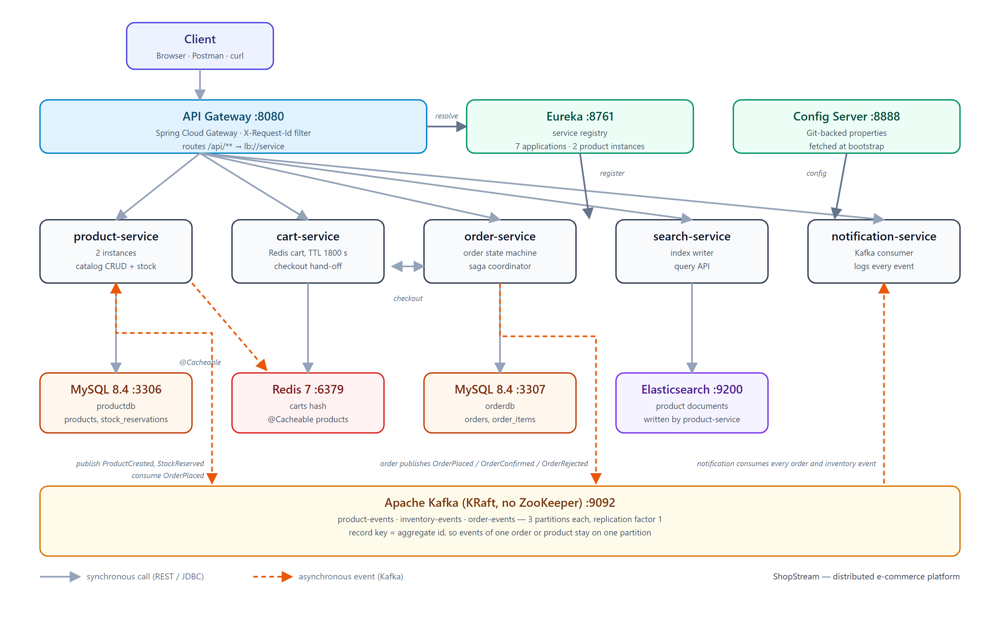

*Figure 0 — the deployed topology. Solid arrows are synchronous calls (gateway
routing, Feign, JDBC); dashed orange arrows are Kafka events. Every service
registers in Eureka and reads its configuration from the Config Server; only the
gateway is reachable from outside. The diagram is generated by
`scripts/render_architecture.py` (SVG), so it can be regenerated after a change.*

The whole system starts with one command:

```
docker compose up -d --build
```

`docker-compose.yml` publishes a single host port, `8080`, for `api-gateway`.
Every other container is reachable only on the internal Compose network.
`docker-compose.dev.yml` is an optional overlay that publishes the infrastructure
ports for inspection during development; it is not part of the submission
configuration.

`config-repo/` is mounted into `config-server` and holds the shared
`application.yml` plus one file per service. Database URLs, Kafka addresses,
consumer groups and the three topic names are defined there, not in the Java
code.

**Repository layout.** One folder per service — `product-service/`,
`order-service/`, `cart-service/`, `search-service/`, `notification-service/`,
`discovery-server/`, `config-server/`, `api-gateway/` — plus `config-repo/`,
`postman/`, `scripts/` and `docs/`. `docker-compose.yml` and `README.md` are in
the root. `docs/` holds this report, the architecture diagram, the screenshots
and the scripts that regenerate them. Appendix B maps every task of the project
description to the code that implements it and to the evidence that shows it
running.

## 2. Step 1 — Docker and one MySQL database per service

### 2.1 How it was developed

**Product service.** `Product` is a JPA entity (`@Entity`, `@Table(name =
"products")`) with the fields required by the task: `id`, `name`, `description`,
`category`, `price`, `stock`. `ProductRepository` extends `JpaRepository`,
`ProductService` contains the use cases, and `ProductController` exposes
`GET/POST/PUT/DELETE /products` with Bean Validation on the request body.

**Order service.** `Order` and `OrderItem` are entities; `OrderService` creates
an order from a list of `{productId, quantity}`, reads the current price from
product-service through Feign and stores a price snapshot. `OrderController`
exposes `POST /orders` and `GET /orders/{id}`.

**Database.** Both services use MySQL 8.4 through `com.mysql:mysql-connector-j`.
The driver is selected explicitly (`com.mysql.cj.jdbc.Driver`) and Hibernate
creates/updates the schema (`spring.jpa.hibernate.ddl-auto: update`). There is no
shared schema: `productdb` belongs to product-service, `orderdb` belongs to
order-service.

**Containers.** Each service has a multi-stage `Dockerfile` (Maven build stage +
JRE run stage). `docker-compose.yml` defines:

- `product-mysql` (`mysql:8.4`, `MYSQL_DATABASE=productdb`) and `order-mysql`
  (`mysql:8.4`, `MYSQL_DATABASE=orderdb`), each with a named volume
  (`product-mysql-data`, `order-mysql-data`) and a `mysqladmin ping` health check;
- every service with its connection data in environment variables
  (`SPRING_DATASOURCE_URL`, `SPRING_DATASOURCE_USERNAME`,
  `SPRING_DATASOURCE_PASSWORD`, `SPRING_KAFKA_BOOTSTRAP_SERVERS`, ...);
- `depends_on` with `condition: service_healthy`, so the services start only
  after their database, Redis and Kafka are ready.

Example configuration (from `config-repo/product-service.yml`, the container
values are supplied by Compose):

```
spring:
  datasource:
    url: ${SPRING_DATASOURCE_URL:jdbc:mysql://localhost:3306/productdb?useSSL=false&allowPublicKeyRetrieval=true&serverTimezone=UTC}
    driver-class-name: com.mysql.cj.jdbc.Driver
```

### 2.2 Why this approach

One database per service is the point of the step: it enforces the service
boundary at the data layer, so a service cannot bypass another service's logic by
reading its tables. MySQL is used because that is what the project description
asks for. All host names inside containers are Compose service names
(`product-mysql`, `kafka`, `redis`), never `localhost`; the `localhost` values
exist only as defaults for running a single service outside Docker.

### 2.3 Evidence

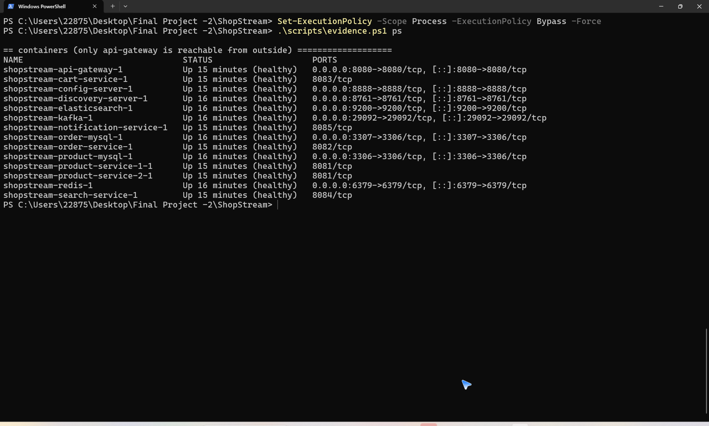

*Screenshot 1.1 — `docker compose ps` (output collected by `scripts/evidence.ps1 ps`). All fourteen containers report `healthy`. Only `api-gateway` publishes a host port, `0.0.0.0:8080->8080/tcp`; the two MySQL containers show 3306 and 3307 only because the developer overlay was used to take the screenshots.*

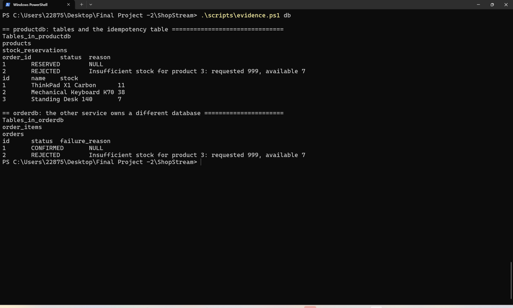

*Screenshot 1.2 — the two databases. `productdb` holds `products` and the idempotency table `stock_reservations`; `orderdb` holds `orders` and `order_items`. The two tables are in different containers and no table is shared.*

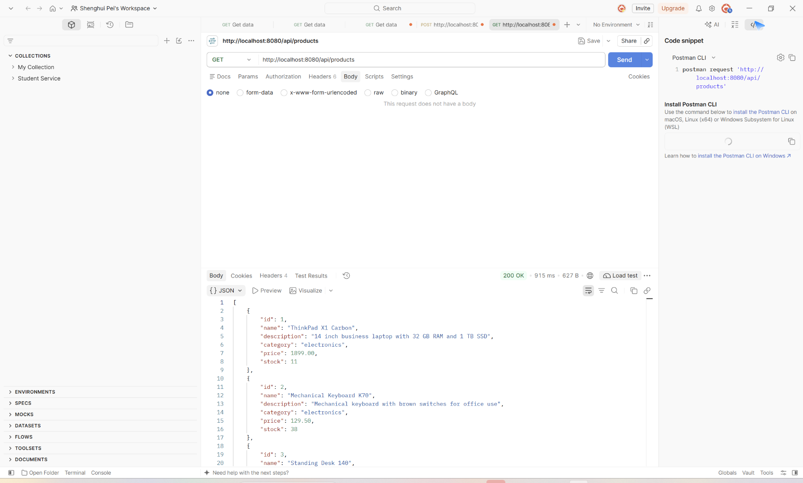

*Screenshot 1.3 — `GET http://localhost:8080/api/products` in Postman (`200 OK`, 915 ms). The same collection contains the `POST`, `PUT` and `DELETE` requests for the CRUD part of the task.*

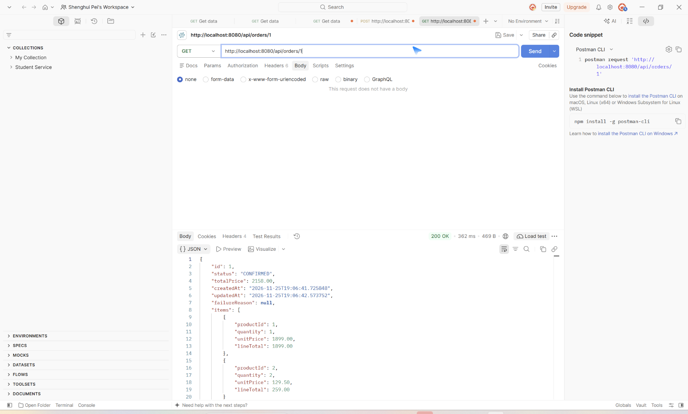

*Screenshot 1.4 — `GET http://localhost:8080/api/orders/1` returning `status: "CONFIRMED"` after the asynchronous stock step. `POST /api/orders` is the request that created it, and it returned `PENDING` (see Screenshot 2.5).*

## 3. Step 2 — Kafka

### 3.1 How it was developed

**Broker.** `docker-compose.yml` runs a single `apache/kafka:3.9.1` container in
KRaft mode: `KAFKA_PROCESS_ROLES=broker,controller`, a controller quorum of one
node and no ZooKeeper container.

**Topics.** `KafkaTopicConfig` in product-service and order-service declares the
three topics from Java, with three partitions and replication factor one:

```
@Bean
public NewTopic orderEventsTopic() {
    return TopicBuilder.name(orderEvents).partitions(3).replicas(1).build();
}
```

The names are injected from config-server (`app.topics.order-events`, ...), so
the topic configuration is visible in one place together with the Kafka
settings.

**Producing.** Both producers use `KafkaTemplate<String, Object>`. The value
serializer is `JsonSerializer`, the key serializer `StringSerializer`, and type
headers are disabled so no Java class name travels between services:

```
EventMessage event = new EventMessage(eventId, eventType, Instant.now().toString(),
        objectMapper.valueToTree(payload));
kafkaTemplate.send(topic, key, event);
```

`EventPublisher.publish(topic, key, eventType, payload)` is the only place that
talks to Kafka; it logs the topic, key, partition and offset of every record.
The key is always the aggregate id — `orderId` for `order-events` and
`inventory-events`, `productId` for `product-events` — so all events of one
order (or product) are written to the same partition.

**Consuming.** Each consumer uses `@KafkaListener` with a JSON value
deserializer (`JsonDeserializer`) and a service-specific consumer group:

| Service | Listener | Topic | Group |
| --- | --- | --- | --- |
| product-service | `OrderEventsListener` | `order-events` | `product-service` |
| order-service | `InventoryEventsListener` | `inventory-events` | `order-service` |
| search-service | `ProductEventsListener` | `product-events` | `search-service` |
| notification-service | `NotificationListener` (2 methods) | `order-events`, `inventory-events` | `notification-service` |

The JSON envelope is the same in every service:

```
{ "eventId": "...", "eventType": "OrderPlaced", "occurredAt": "...", "payload": { ... } }
```

Each service has its own small `EventMessage` record, so the consumer does not
depend on the producer's classes. `JsonDeserializer` maps the record value onto
that record, and the listener reads the payload field by field.

**Order workflow.** `OrderService` saves the order as `PENDING` and raises
`OrderPlacedEvent`. `OrderEventPublisher` is a
`@TransactionalEventListener(phase = AFTER_COMMIT)`, so `OrderPlaced` is published
only after the transaction commits. product-service consumes it, locks the
referenced product rows with `SELECT ... FOR UPDATE` inside one transaction,
checks stock and either decrements every item or rolls the whole transaction
back. It then publishes `StockReserved` or `StockRejected` to
`inventory-events`. order-service consumes that result and moves the order from
`PENDING` to `CONFIRMED` or `REJECTED`.

**Idempotency (task 8).** `stock_reservations.order_id` is the primary key: a
redelivered `OrderPlaced` finds the existing row and republishes the previous
result instead of reserving stock again. In order-service the state machine only
accepts a transition from `PENDING`, so a duplicate `StockReserved` /
`StockRejected` is a no-op. notification-service additionally remembers the
`eventId`s it has already logged.

### 3.2 Why this approach

Kafka decouples the order workflow from inventory: order-service does not have to
wait for product-service, and a temporarily unavailable consumer only delays the
confirmation instead of failing the checkout. Using the aggregate id as the key
is what makes the per-order ordering guarantee possible. At-least-once delivery
is handled with idempotent consumers rather than with transactions across
services, which would not scale.

### 3.3 Evidence

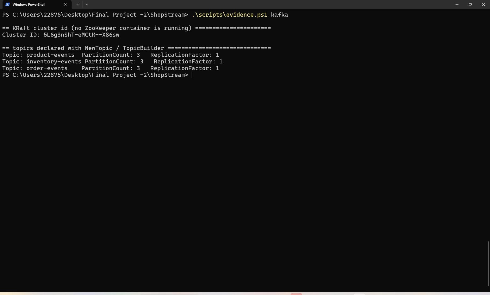

*Screenshot 2.1 — `kafka-cluster.sh cluster-id` returns `5L6g3nShT-eMCtK--X86sw`. The broker works in KRaft mode: there is no ZooKeeper container in `docker compose ps`. Screenshot 2.2 is the lower half of the same image: every topic created by `TopicBuilder` has `PartitionCount: 3` and `ReplicationFactor: 1`.*

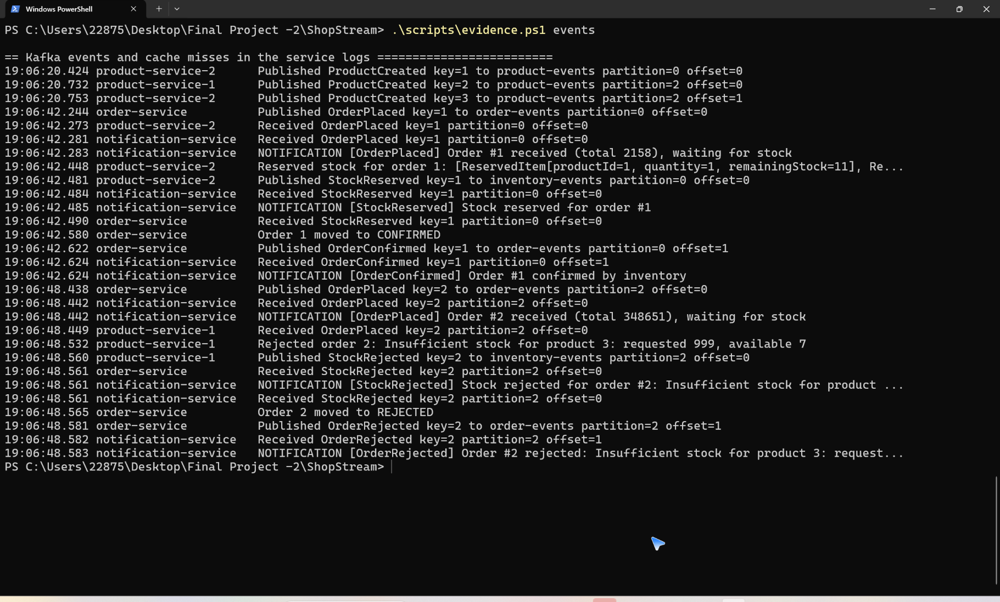

*Screenshot 2.3 — the event timeline, produced by `scripts/evidence.ps1 events`, which merges the logs of order-service, both product instances and notification-service in time order. It contains the producer line with key, partition and offset (`Published ProductCreated key=1 ... partition=0 offset=0`), the consumer lines of both product instances (Screenshot 2.4: `key=1` handled by product-service-2 on partition 0, `key=2` handled by product-service-1 on partition 2), and the two state transitions. Screenshot 2.5: order 1 moves `PENDING` → `CONFIRMED` at 19:06:42.580. Screenshot 2.6: order 2 is rejected at 19:06:48.565 with `Insufficient stock for product 3: requested 999, available 7`.*

*Screenshot 2.7 — idempotency is visible in the `stock_reservations` table of Screenshot 1.2: one row per order, `order_id` as primary key, `status` `RESERVED` for order 1 and `REJECTED` with the reason for order 2. A redelivered `OrderPlaced` finds the row and republishes the stored result instead of reserving stock twice.*

## 4. Step 3 — Elasticsearch

### 4.1 How it was developed

**Container.** `docker-compose.yml` runs a single-node
`docker.elastic.co/elasticsearch/elasticsearch:8.15.3` with
`discovery.type=single-node`, `xpack.security.enabled=false` and a 512 MB heap
(`ES_JAVA_OPTS`).

**Mapping.** `ProductDocument` defines the index explicitly:

```
@Document(indexName = "products", createIndex = true, writeTypeHint = WriteTypeHint.FALSE)
@Setting(shards = 1, replicas = 0)
public class ProductDocument {
    @Id private Long id;
    @MultiField(mainField = @Field(type = FieldType.Text),
                otherFields = @InnerField(suffix = "keyword", type = FieldType.Keyword))
    private String name;
    @Field(type = FieldType.Text) private String description;
    @Field(type = FieldType.Keyword) private String category;
    @Field(type = FieldType.Double) private Double price;
    @Field(type = FieldType.Integer) private Integer stock;
}
```

`SearchIndexInitializer` creates the index with that mapping at startup, before
the first event arrives, so Elasticsearch never has to guess a field type from a
document. The documents themselves are added by the consumer below; because the
consumer group starts with `auto-offset-reset: earliest`, the `ProductCreated`
events that were published before search-service started are replayed, so the
index catches up without a separate backfill.

**Index maintenance.** `ProductEventsListener` consumes `product-events` and
uses the repository: `save(document)` for `ProductCreated` / `ProductUpdated`,
`deleteById(id)` for `ProductDeleted`. The document is built from the event
payload, so search-service never calls product-service.

**Querying.** `SearchService` deliberately uses both APIs:

- one criterion (category only, no text, no price, no sort) goes through the
  derived repository method `findByCategory(String, Pageable)`;
- the combined query is a `NativeQuery` executed with
  `ElasticsearchOperations`:

```
BoolQuery.Builder bool = new BoolQuery.Builder();
bool.must(m -> m.multiMatch(mm -> mm.query(text).fields("name^2", "description")
                                  .operator(Operator.And)));
bool.filter(f -> f.term(t -> t.field("category").value(category)));
bool.filter(f -> f.range(r -> r.field("price").gte(min).lte(max)));

NativeQuery query = NativeQuery.builder()
        .withQuery(q -> q.bool(bool.build()))
        .withPageable(PageRequest.of(page, size))
        .withSort(sort)
        .withTrackTotalHits(true)
        .build();

SearchHits<ProductDocument> hits = operations.search(query, ProductDocument.class);
```

`GET /search` accepts `text`, `category`, `minPrice`, `maxPrice`, `page`, `size`
and `sort` (`priceAsc`, `priceDesc`, `nameAsc`). Text is searched in `name`
(boosted ×2) and `description`; category is an exact term on the keyword field;
price is a range filter.

### 4.2 Why this approach

A method name cannot express "must match text AND filter by category AND filter
by price range" with paging and sorting, so the combined case is built with the
query DSL and executed by `ElasticsearchOperations`, which also gives access to
the total hit count. The simple case stays a derived repository method because it
is readable and needs no query code. `name.keyword` exists so the name can also
be sorted and matched exactly.

### 4.3 Evidence

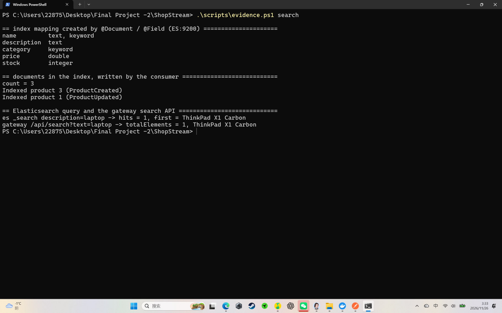

*Screenshot 3.1 — reading the live mapping from `GET http://localhost:9200/products/_mapping`: `name` is `text` with a `keyword` sub-field, `description` is `text`, `category` and `price` and `stock` are `keyword`, `double` and `integer`. These are exactly the `@Field` annotations of `ProductDocument`, so the index was not guessed by Elasticsearch.*

*Screenshot 3.2 and 3.3 — the lower half shows `count = 3` documents, the query `description=laptop` returning one hit (`ThinkPad X1 Carbon`) and the same result through the gateway, `GET /api/search?text=laptop` → `totalElements = 1`.*

*Screenshot 3.4 — the two `Indexed product ...` lines are written by `ProductEventsListener`: `ProductCreated` for the two products created after search-service started, and `ProductUpdated` after the product was edited, which shows that the index follows the events and not a scheduled job.*

## 5. Step 4 — Redis

### 5.1 How it was developed

**Container.** `redis:7-alpine` with `--requirepass mypass --appendonly yes` and a
health check. All services read the password from `spring.data.redis.password`.

**Cart as a Redis hash (tasks 2–3).**

```
@RedisHash("carts")
public class Cart implements Serializable {
    @Id private String userId;
    @TimeToLive private Long timeToLive;
    private List<CartItem> items = new ArrayList<>();
    private BigDecimal totalPrice = BigDecimal.ZERO;
    private Instant updatedAt;
}

public interface CartRepository extends CrudRepository<Cart, String> { }
```

The repository key is the `@Id` field, so the Redis key is `carts:{userId}`.
`CartService` only uses `findById`, `save` and `delete`; there is no manual
`RedisTemplate` code and no JSON document. The TTL is refreshed on every write
(`cart.setTimeToLive(1800)` before `save`), so an abandoned cart disappears
after **30 minutes** while an active one keeps sliding.

**Cart API (task 3/4).** `GET /carts/{userId}`, `POST
/carts/{userId}/items`, `PUT /carts/{userId}/items/{productId}`, `DELETE
/carts/{userId}/items/{productId}`, `DELETE /carts/{userId}`. Checkout
(`POST /carts/{userId}/checkout`) sends the cart to order-service through Feign
and deletes the hash only after order-service accepted the order; if the call
fails the cart is kept and the customer can retry.

**Product cache (task 5).** `ProductServiceApplication` is annotated
`@EnableCaching`, and `GET /products/{id}` is cached declaratively:

```
@Cacheable(cacheNames = "products", key = "#id")
public Product get(Long id) { ... }

@CacheEvict(cacheNames = "products", key = "#id")
public Product update(Long id, Product body) { ... }
```

`ProductCacheEvictor` carries the `@CacheEvict` used by the inventory path: after
a successful stock reservation, `ReservationService` registers an
`afterCommit` synchronization that evicts the cached product, so a rollback
never removes a valid cache entry. The cache is Redis-backed
(`spring.cache.type=redis`, TTL 2 minutes).

### 5.2 Why this approach

A hash is the natural Redis representation of a cart: one key per user, one field
per attribute, and the whole key expires as a unit. `@TimeToLive` replaces manual
`EXPIRE` calls and keeps the expiry rule in the entity. The product cache is
declarative for the same reason: the annotation documents the intent
(`@Cacheable` read-through, `@CacheEvict` invalidation) and removes the
cache-aside code from the business method.

### 5.3 Evidence

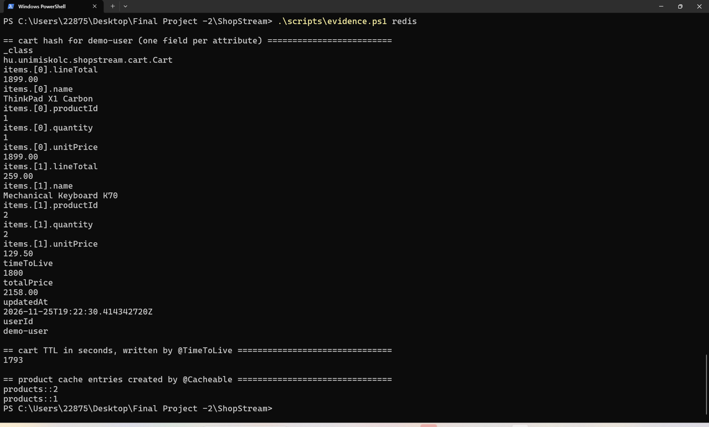

*Screenshot 4.1 — `HGETALL carts:demo-user` returns a hash, not a JSON string: `_class = hu.unimiskolc.shopstream.cart.Cart`, one field per attribute (`items.[0].name`, `items.[0].quantity`, `totalPrice`, `userId`, ...), `timeToLive = 1800`, and `TTL` answers 1793 seconds. The last block lists the keys created by `@Cacheable`, `products::1` and `products::2`.*

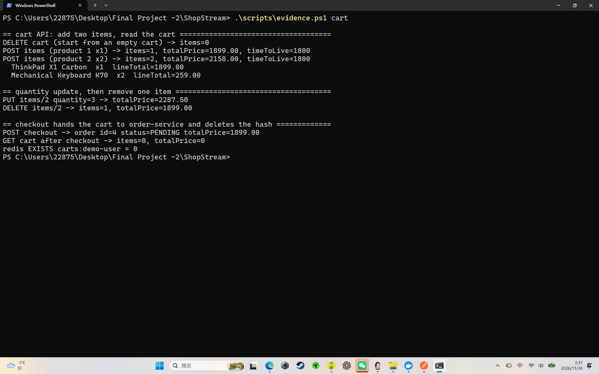

*Screenshot 4.2 — the cart API end to end: add item, add a second item, read the cart, `PUT` the quantity, `DELETE` one item. Every response carries `timeToLive=1800`, so the expiry is refreshed by the write itself.*

*Screenshot 4.3 — `POST /carts/demo-user/checkout` returns the created order (`id=4`, `PENDING`, total 1899.00); the next `GET` of the cart is empty and `EXISTS carts:demo-user` answers `0`: the hash is deleted only after order-service accepted the order.*

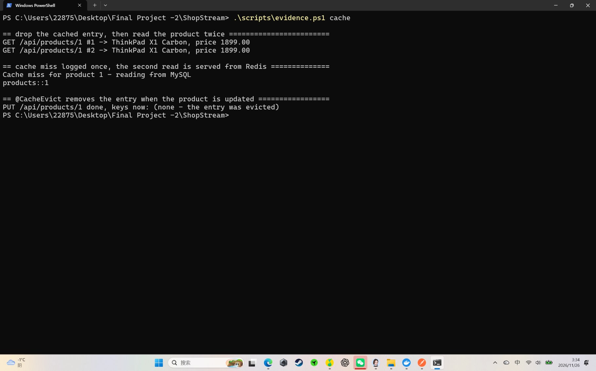

*Screenshot 4.4 — the entry is deleted first, then `GET /api/products/1` is called twice. Exactly one `Cache miss for product 1 - reading from MySQL` line is logged for the two reads, and `products::1` exists afterwards, so the second read came from Redis.*

*Screenshot 4.5 — `PUT /api/products/1` then empties the key set (`(none - the entry was evicted)`): `@CacheEvict` removed `products::1` together with the older entry, so the next read repopulates the cache from MySQL.*

## 6. Step 5 — Spring Cloud

### 6.1 How it was developed

**Discovery (task 1).** `discovery-server` uses `@EnableEurekaServer`. Every
service is an Eureka client with `eureka.client.service-url.defaultZone` pointing
at the container. Two product instances run from the same image:

```
product-service-1:
  build: ./product-service
  environment:
    EUREKA_INSTANCE_INSTANCE_ID: product-service-1
product-service-2:
  build: ./product-service
  environment:
    EUREKA_INSTANCE_INSTANCE_ID: product-service-2
```

Both register under the same application name (`PRODUCT-SERVICE`) with different
instance ids, and both join the `product-service` Kafka consumer group, so
`order-events` partitions are divided between them.

**Configuration (task 2).** `config-server` uses `@EnableConfigServer` with the
native `file` backend over the `config-repo/` folder mounted read-only. It serves
a shared `application.yml` (Eureka, actuator, logging, `app.topics.*`) and one
file per service with the MySQL URL, the Kafka settings and the consumer group.
The services import it with `spring.config.import=configserver:` and
`fail-fast=true`.

**Feign (task 3).** `ProductClient` and `OrderClient` are `@FeignClient`
interfaces that use service names only (`@FeignClient(name = "product-service")`,
`@FeignClient(name = "order-service")`); no host or port appears in the code.
Spring Cloud LoadBalancer resolves the instances through Eureka.

**Gateway (tasks 4–6).** `api-gateway` routes

```
- id: product-service
  uri: lb://product-service
  predicates:
    - Path=/api/products/**
  filters:
    - StripPrefix=1
```

and the same for orders, carts and search. `XRequestIdFilter` is a global
`GlobalFilter`: it reads `X-Request-Id` or creates a UUID, puts it into the
request headers and the response, and logs the method, path and id. Only the
gateway is published in `docker-compose.yml`.

### 6.2 Why this approach

Service names instead of addresses are what make the two product instances
interchangeable: the gateway and Feign see one logical service and Eureka decides
which instance answers. Central configuration keeps the database URLs, Kafka
addresses and topic names out of the images, and the `X-Request-Id` header is the
only way to follow one request across five services in the logs.

### 6.3 Evidence

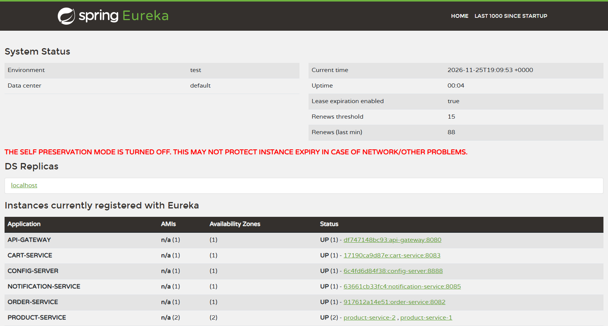

*Screenshot 5.1 — `http://localhost:8761`: seven applications are `UP` (api-gateway, cart-service, config-server, notification-service, order-service, product-service, search-service); `PRODUCT-SERVICE` is expanded to `product-service-1` and `product-service-2`.*

<div class="page-break"></div>

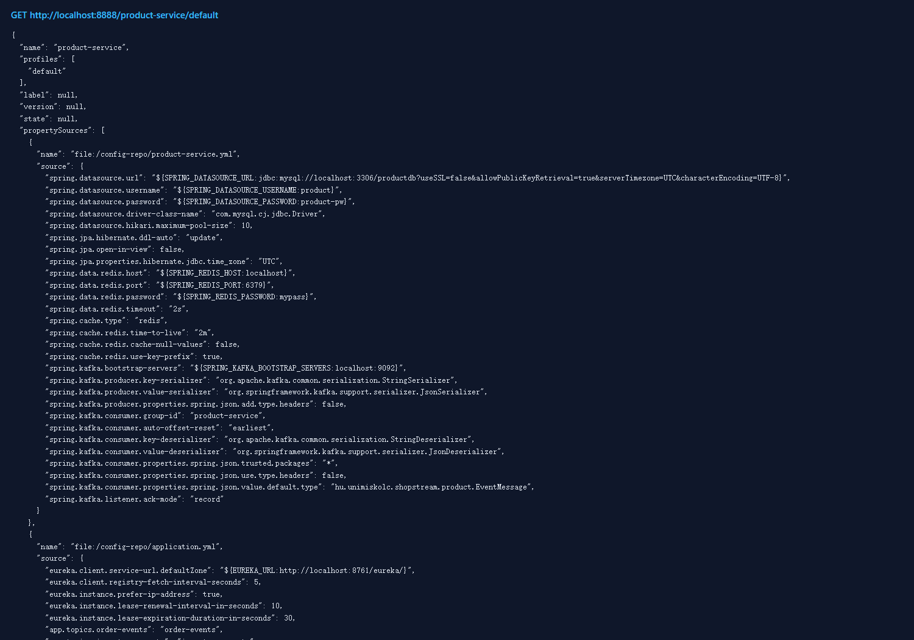

*Screenshot 5.2 — `GET http://localhost:8888/product-service/default`, pretty-printed for legibility. `propertySources` lists `file:/config-repo/product-service.yml` and `file:/config-repo/application.yml`: the MySQL URL and driver, the Redis cache settings, the Kafka serializers with `spring.json.add.type.headers=false` and the consumer group, and `app.topics.*` all come from Git-style files, not from the image.*

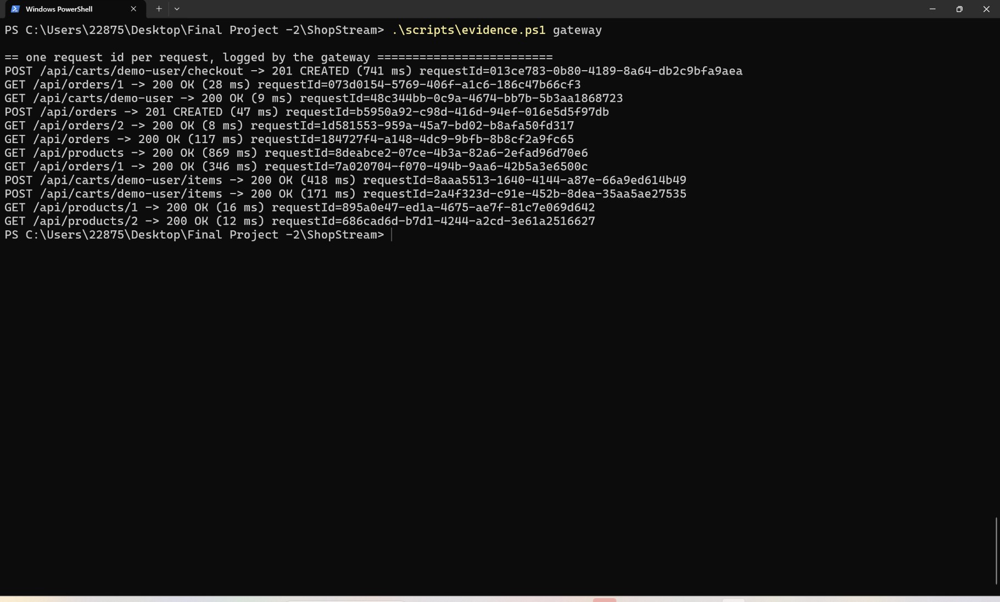

*Screenshot 5.3 — the `XRequestIdFilter` line of the gateway for twelve consecutive requests: method, path, status, duration and one `requestId` per request. The same id is returned in the `X-Request-Id` response header, which is how a client-side log line can be matched to the gateway and service logs.*

*Screenshot 5.4 — load balancing is visible in Screenshot 2.4: `key=1` is consumed by product-service-2 on partition 0 and `key=2` by product-service-1 on partition 2, so both instances of the same logical service take part in the work. The gateway itself resolves `lb://product-service` to one of the two registered instances.*

## 7. Testing

Unit tests (JUnit 5 + Mockito, no Docker required):

| Module | Test class | What it covers |
| --- | --- | --- |
| product-service | `ProductServiceTest` | CRUD, missing product, domain event on create/delete |
| product-service | `ReservationServiceTest` | reservation order, insufficient stock, duplicate `OrderPlaced`, rejection, cache eviction |
| order-service | `OrderServiceTest` | price snapshot, total, `PENDING` state, `OrderPlacedEvent` |
| order-service | `InventoryEventsListenerTest` | `StockReserved` → confirm, `StockRejected` → reject |
| cart-service | `CartServiceTest` | empty cart, add item, stock limit, quantity 0, checkout and delete |
| cart-service | `CartControllerTest` | REST layer |
| search-service | `ProductEventsListenerTest` | create/update indexing, delete, unknown events |
| search-service | `SearchIndexInitializerTest` | index creation |
| notification-service | `NotificationListenerTest` | one line per event, duplicate `eventId`, rejection reason |

```
.\scripts\run-tests.ps1
```

The script finds a JDK, runs `mvn test` module by module and prints one line per
service. It needs Maven 3.9 and JDK 21 or newer; on a JDK above 23 the Mockito
agent needs `-DargLine=-Dnet.bytebuddy.experimental=true`, which the script adds.

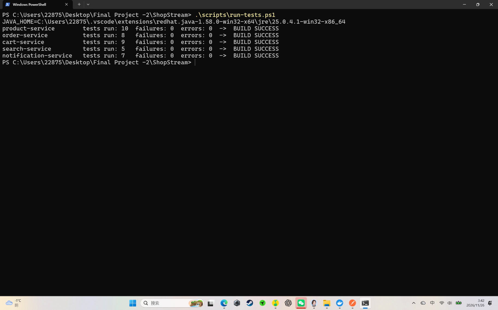

*Screenshot 6.1 — the five suites on this machine: product-service 10 tests,
order-service 8, cart-service 9, search-service 5, notification-service 7 —
39 tests, no failures, no errors, `BUILD SUCCESS` for every module.*

## 8. Notes and limitations

- Kafka delivery is at-least-once. Duplicates are handled by the
  `stock_reservations` primary key, the order state machine and the
  notification `eventId` set, not by exactly-once transactions.
- `@CacheEvict` on update/delete runs when the annotated method returns; the
  inventory path evicts after commit through `ProductCacheEvictor`, because a
  rollback must not remove a valid entry.
- notification-service stores nothing (as required); its small in-memory list and
  the `GET /notifications` endpoint exist only to make the asynchronous flow
  visible in the demo.
- The search index is eventually consistent: a product is searchable a moment
  after `ProductCreated` is consumed.
- The services keep their configuration in `config-repo`; the `localhost`
  defaults there are only for running a single service outside Docker.

## Appendix A — Screenshot checklist

All screenshots are in `docs/screenshots/`. The terminal ones were produced by
`scripts/evidence.ps1 <section>` against the running stack, so the whole
appendix can be regenerated:

```
docker compose -f docker-compose.yml -f docker-compose.dev.yml up -d --build
.\scripts\evidence.ps1 all
.\scripts\run-tests.ps1
```

| # | File | What it shows | How to reproduce |
| --- | --- | --- | --- |
| 1.1 | `03-docker-ps.png` | 14 containers `healthy`, one published port | `.\scripts\evidence.ps1 ps` |
| 1.2 | `07-mysql-dbs.png` | `productdb` and `orderdb`, `stock_reservations`, order states | `.\scripts\evidence.ps1 db` |
| 1.3 | `01-postman-products.png` | `GET /api/products` through the gateway, 200 OK | Postman collection `postman/` |
| 1.4 | `02-postman-order-confirmed.png` | `GET /api/orders/1` → `CONFIRMED` | Postman |
| 2.1 | `05-kafka-kraft-topics.png` | KRaft cluster id, no ZooKeeper | `.\scripts\evidence.ps1 kafka` |
| 2.2 | same file | three topics, 3 partitions, RF 1 | same command |
| 2.3 | `04-events-timeline.png` | producer lines with key/partition/offset | `.\scripts\evidence.ps1 events` |
| 2.4 | same file | both product instances consuming different partitions | same command |
| 2.5 | same file, plus 1.4 | `PENDING` → `CONFIRMED` | checkout, then `GET /api/orders/{id}` |
| 2.6 | same file, plus 1.2 | rejected order and `failureReason` | order with `quantity: 999` |
| 2.7 | `07-mysql-dbs.png` | `stock_reservations` one row per order id | `.\scripts\evidence.ps1 db` |
| 3.1 | `10-elasticsearch-index.png` | live mapping produced by `@Document` / `@Field` | `.\scripts\evidence.ps1 search` |
| 3.2 | same file | document count and an `_search` hit | same command |
| 3.3 | same file | `GET /api/search?text=laptop` → `totalElements = 1` | same command |
| 3.4 | same file | `Indexed product ...` lines from the consumer | same command |
| 4.1 | `06-redis-cart-cache.png` | cart hash, `TTL`, `products::*` keys | `.\scripts\evidence.ps1 redis` |
| 4.2 | `13-cart-api.png` | add, read, update, remove through the gateway | `.\scripts\evidence.ps1 cart` |
| 4.3 | same file | checkout returns the order, cart deleted | same command |
| 4.4 | `11-cache-miss-hit.png` | one `Cache miss` line for two reads, key present | `.\scripts\evidence.ps1 cache` |
| 4.5 | same file | `@CacheEvict` removes the entry after `PUT` | same command |
| 5.1 | `09-eureka-dashboard.png` | seven applications, two product instances | `http://localhost:8761` |
| 5.2 | `12-config-server.png` | `product-service/default` from `config-repo` | `http://localhost:8888/product-service/default` |
| 5.3 | `08-gateway-request-id.png` | one `requestId` per request in the gateway log | `.\scripts\evidence.ps1 gateway` |
| 5.4 | `04-events-timeline.png` | `key=1` on instance 2, `key=2` on instance 1 | `.\scripts\evidence.ps1 events` |
| 6.1 | `14-unit-tests.png` | 39 tests, 0 failures, `BUILD SUCCESS` × 5 | `.\scripts\run-tests.ps1` |
| — | `shopstream-architecture.png` | Figure 0, the deployed topology | `python scripts\render_architecture.py`, then rasterise the SVG |

## Appendix B — Task coverage against the project description

Every task of `Semester Project: ShopStream` is listed below with the code that
implements it and the evidence in this report. Class names are given so a
reviewer can check the implementation without searching the repository.

### Step 1 — Docker

| Task | Requirement | Implementation | Evidence |
| --- | --- | --- | --- |
| 1.1 | product-service REST API for create, read, update, delete and list, with `id`, `name`, `description`, `category`, `price`, `stock` | `Product` entity, `ProductRepository`, `ProductService`, `ProductController` (`GET`, `GET /{id}`, `POST`, `PUT /{id}`, `DELETE /{id}`) with Bean Validation | §2.1, Screenshot 1.3 |
| 1.2 | order-service `POST /orders` with a list of `productId` + `quantity`, `GET /orders/{id}`, price read over HTTP | `OrderController`, `OrderService`, `OrderItemRequest`, `CreateOrderRequest`; the price comes from `ProductClient` (`@FeignClient(name = "product-service")`, the Step 5 form of the HTTP call) | §2.1, Screenshot 1.4 |
| 1.3 | one `Dockerfile` per service | eight multi-stage Dockerfiles (build stage + JRE run stage), one per module | §2.1, Screenshot 1.1 |
| 1.4 | `docker-compose.yml` with both services and one MySQL container per service, named volumes, environment variables, `depends_on` | `product-mysql` / `order-mysql` (`mysql:8.4`, `MYSQL_DATABASE`), volumes `product-mysql-data` / `order-mysql-data`, `depends_on` with `condition: service_healthy` | §2.1, Screenshots 1.1 and 1.2 |
| 1.5 | connection settings only in environment variables, nothing may point to `localhost` inside a container | container environment checked with `printenv`: `jdbc:mysql://product-mysql:3306/...`, `kafka:9092`, `redis`, `http://config-server:8888`, `http://discovery-server:8761/eureka/`; `localhost` exists only as a default for running one service outside Docker | §2.2, Screenshot 1.1 |
| — | five business and three infrastructure services, one command to start | product, order, cart, search, notification + Eureka, Config Server, gateway; `docker compose up -d --build` | §1, Screenshot 1.1 |

### Step 2 — Kafka

| Task | Requirement | Implementation | Evidence |
| --- | --- | --- | --- |
| 2.1 | one Kafka broker in KRaft mode | `apache/kafka:3.9.1` with `KAFKA_PROCESS_ROLES=broker,controller`, single-node controller quorum, no ZooKeeper | §3.1, Screenshot 2.1 |
| 2.2 | three topics from configuration classes with `NewTopic` / `TopicBuilder`, 3 partitions each | `KafkaTopicConfig` in product-service and order-service; names from `app.topics.*` in config-server | §3.1, Screenshot 2.2 |
| 2.3 | events as JSON (`JsonSerializer` / `JsonDeserializer`), `orderId` or `productId` as the message key | `EventPublisher`, `EventMessage`, `spring.kafka.producer.value-serializer=JsonSerializer`, `JsonDeserializer` per consumer, `spring.json.add.type.headers=false`; key = aggregate id | §3.1, Screenshot 2.3 |
| 2.4 | order-service saves the order as `PENDING` and publishes `OrderPlaced` with `KafkaTemplate` | `OrderService` + `OrderEventPublisher` (`@TransactionalEventListener(AFTER_COMMIT)`) using `KafkaTemplate<String, Object>` | §3.1, Screenshot 2.3 |
| 2.5 | product-service: `@KafkaListener` in group `product-service`, reserves stock in one database transaction, publishes `StockReserved` / `StockRejected` | `OrderEventsListener`, `ReservationService` (`SELECT ... FOR UPDATE`, one transaction, `stock_reservations` row), `ProductEventPublisher` | §3.1, Screenshots 2.3 and 2.7 |
| 2.6 | order-service consumes `inventory-events` and sets `CONFIRMED` or `REJECTED` | `InventoryEventsListener`, `OrderService.applyInventoryResult` | §3.1, Screenshots 2.3, 2.5 and 2.6 |
| 2.7 | notification-service: group `notification-service` on `order-events` and `inventory-events`, one "email" log per final order status | `NotificationListener` (two `@KafkaListener` methods, same group), `NotificationStore` | §3.1, Screenshot 2.3 |
| 2.8 | stock reservation is idempotent | `stock_reservations.order_id` primary key: a redelivered `OrderPlaced` republishes the stored result; the order state machine only accepts a transition from `PENDING` | §3.1, Screenshot 2.7 |

### Step 3 — Elasticsearch

| Task | Requirement | Implementation | Evidence |
| --- | --- | --- | --- |
| 3.1 | single-node Elasticsearch container, security disabled, memory limit through `ES_JAVA_OPTS` | `elasticsearch:8.15.3` with `discovery.type=single-node`, `xpack.security.enabled=false`, `ES_JAVA_OPTS=-Xms512m -Xmx512m` | §4.1, Screenshot 1.1 |
| 3.2 | product-service publishes `ProductCreated`, `ProductUpdated`, `ProductDeleted` | `ProductEventPublisher`, called from `ProductService` create / update / delete | §4.1, Screenshot 3.4 |
| 3.3 | search-service consumes `product-events` and maintains a `products` index through an `ElasticsearchRepository` | `ProductEventsListener` → `ProductSearchRepository extends ElasticsearchRepository<ProductDocument, Long>` (`save`, `deleteById`) | §4.1, Screenshots 3.2 and 3.4 |
| 3.4 | explicit mapping with `@Document` / `@Field`: name text, category keyword, price double, stock integer | `ProductDocument` (`@Document(indexName = "products")`, `@MultiField` for `name`, `@Field(Text)` description, `@Field(Keyword)` category, `@Field(Double)` price, `@Field(Integer)` stock) | §4.1, Screenshot 3.1 |
| 3.5 | `GET /search` with a text query on name and description, optional category, optional price range and paging; derived methods for simple cases, `ElasticsearchOperations` for the combined query | `SearchController` (`text`, `category`, `minPrice`, `maxPrice`, `page`, `size`, `sort`), `SearchService` (`findByCategory(String, Pageable)` and `NativeQuery` + `ElasticsearchOperations`) | §4.1, Screenshot 3.3 |

### Step 4 — Redis

| Task | Requirement | Implementation | Evidence |
| --- | --- | --- | --- |
| 4.1 | Redis container with a password, services configured through `spring.data.redis.*` | `redis:7-alpine` with `--requirepass`, health check; every service reads `spring.data.redis.host/password` | §5.1, Screenshot 4.1 |
| 4.2 | cart-service with a `@RedisHash("carts")` entity and a `CrudRepository`, keyed by `userId` | `Cart` (`@RedisHash("carts")`, `@Id userId`, `@TimeToLive`, `items`), `CartRepository extends CrudRepository<Cart, String>` | §5.1, Screenshot 4.1 |
| 4.3 | cart API: get, add item, change quantity, remove item, empty cart; carts expire with `@TimeToLive`, period documented in the README | `CartController` (`GET /carts/{userId}`, `POST /items`, `PUT /items/{productId}`, `DELETE /items/{productId}`, `DELETE /carts/{userId}`); TTL 1800 s, refreshed on every write, stated in `README.md` | §5.1, Screenshots 4.1 and 4.2 |
| 4.4 | `POST /carts/{userId}/checkout` sends the cart to order-service and clears it only if the order was accepted | `CartService.checkout`: `OrderClient` call, then `clear(userId)`; a failed call keeps the cart and the customer can retry | §5.1, Screenshot 4.3 |
| 4.5 | product-service caches `GET /products/{id}` with `@Cacheable` and evicts with `@CacheEvict` when the product changes or stock is reserved | `@EnableCaching`, `ProductService.@Cacheable` / `@CacheEvict`, `ProductCacheEvictor` for the reservation path (eviction in `afterCommit`) | §5.1, Screenshots 4.4 and 4.5 |

### Step 5 — Spring Cloud

| Task | Requirement | Implementation | Evidence |
| --- | --- | --- | --- |
| 5.1 | discovery-server with `@EnableEurekaServer`, every service registered, two instances of product-service | `DiscoveryServerApplication`, Eureka clients in all services, `product-service-1` / `product-service-2` from the same image with different instance ids | §6.1, Screenshot 5.1 |
| 5.2 | config-server with `@EnableConfigServer` backed by a repository folder, database URLs, Kafka settings and topic names there, shared `application.yml` | `ConfigServerApplication`, native `file` backend over `config-repo/`, `spring.config.import=configserver:` with `fail-fast=true` | §6.1, Screenshot 5.2 |
| 5.3 | replace hard-coded HTTP calls with `@FeignClient` interfaces that use service names only | `ProductClient`, `OrderClient` (`@FeignClient(name = "product-service")`, `@FeignClient(name = "order-service")`), no host or port in the code | §6.1, Screenshots 1.4 and 4.3 |
| 5.4 | api-gateway with Spring Cloud Gateway, routes for `/api/products/**`, `/api/orders/**`, `/api/carts/**`, `/api/search/**` to `lb://` with `StripPrefix` | `GatewayRoutesConfig` (`RouteLocatorBuilder`, four routes, `stripPrefix(1)`, `lb://`) | §6.1, Screenshots 1.3 and 5.3 |
| 5.5 | one custom global filter that sets `X-Request-Id` and logs it | `XRequestIdFilter` (`GlobalFilter`): reuses the incoming header or creates a UUID, returns it in the response, logs method, path, status and id | §6.1, Screenshot 5.3 |
| 5.6 | publish only the gateway port, everything else on the internal network | `docker-compose.yml` publishes only `8080:8080`; the other ports exist only in the optional `docker-compose.dev.yml` | §1, Screenshot 1.1 |
